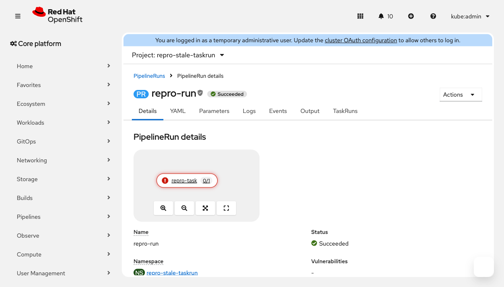

# Repro: stale same-name TaskRun in Tekton Results → wrong (failed) status in the console PipelineRun topology

Reproducer for the `openshift-pipelines/console-plugin` issue:
**PipelineRun topology shows a task as failed when a stale same-name TaskRun from a previous
PipelineRun is still in Tekton Results** (see linked Jira issue).


*`repro-task` node: red "!" (`pf-m-danger`) + `0/1`, although the current TaskRun is Succeeded (exit 0).*

## Versions tested (bug present in both)

| operator (CSV) | Tekton Pipelines | console-plugin image (digest) | result |
|---|---|---|---|
| 1.23.4 | v1.12.3 | `pipelines-console-plugin-pf5-rhel9@f36637b4…` | **bug PRESENT** (`docs/bug-evidence.png`) |
| 1.24.3 | v1.15.5 | `pipelines-console-plugin-pf5-rhel9@33cb80d0…` | **bug PRESENT** (`docs/bug-evidence-v1.24.3.png`) |

On 1.24.3 the node shows the same wrong state: `pf-m-danger` + `0/1` while the K8s TaskRun
is `True Succeeded`. The issue is still unfixed in the topology view: on `release-v1.24.x`
(and `main`, `release-v1.25.x`) `PipelineRunVisualization.tsx` still calls
`useTaskRuns(ns, name, undefined, undefined, …)`, i.e. `pipelineRunUid` is **not** passed,
so the Results query is not narrowed to the current run's UID and the stale failed record
wins.

## Prerequisites
- OpenShift Pipelines installed (tested with operator 1.23.4 / Tekton Pipelines v1.12.3
  **and** 1.24.3 / Tekton Pipelines v1.15.5 — bug present in both)
- **Tekton Results enabled** (`tekton-results-api` deployment present in `openshift-pipelines`)
- a user with permission to create namespaces + tekton resources
- cluster reachable with `oc`

## Reproduce (3 commands)

```sh
# 0. clone
git clone https://github.com/gmeghnag/stale-taskrun-repro && cd stale-taskrun-repro

# 1. run #1: task FAILS (exit 1), then delete the PipelineRun
oc apply -k run1-fail
oc wait --for=condition=Succeeded=false pipelinerun/repro-run -n repro-stale-taskrun --timeout=5m
oc delete pipelinerun repro-run -n repro-stale-taskrun --wait=false

# 2. run #2: SAME NAME, task SUCCEEDS (exit 0)
oc apply -k run2-succeed
oc wait --for=condition=Succeeded=True pipelinerun/repro-run -n repro-stale-taskrun --timeout=5m

# 3. open the console:
#    repro-stale-taskrun -> Pipelines -> Pipeline Runs -> repro-run -> Overview
#    => the "repro-task" node shows a RED "!" (pf-m-danger) and "0/1",
#       although the TaskRun succeeded
```

Verify the API ground truth (the current run is fine):

```sh
oc get taskrun repro-run-repro-task -n repro-stale-taskrun \
  -o jsonpath='{.status.conditions[0].status} {.status.conditions[0].reason}{"\n"}'
# True Succeeded
```

Note: the failing run's failure reason does not matter (`StepFailed`/`PodCreationFailed`
both work) — what matters is that run #1 fails, gets deleted, and leaves its TaskRun record
in Tekton Results, while run #2 reuses the same name and succeeds.

## Why it happens (short)
The console plugin fetches the run's TaskRuns from the K8s API **and** from the Tekton
Results API. The Results query filters only by label
`tekton.dev/pipelineRun=<name>` (no UID), so the record left by the **deleted** run #1
(failed) comes back together with the record of the current run #2 (succeeded). The merge
dedupes by `metadata.uid` (both survive) and the task status is taken from the **first**
match by `tekton.dev/pipelineTask` label — which is the stale failed one.

Relevant code: `pipelineRuns-details/PipelineRunVisualization.tsx` (does not pass
`pipelineRunUid`), `hooks/useTaskRuns.ts` (`uniqBy(..., metadata.uid)`),
`utils/pipeline-utils.ts` (`appendPipelineRunStatus` → `_.find` by task label).

## Cleanup

```sh
oc delete namespace repro-stale-taskrun
```

(Optionally also purge the stale records from Tekton Results; otherwise the bug simply
can't be reproduced again in that namespace until a new same-name cycle is created.)

## Layout

| path | what |
|---|---|
| `base/` | namespace `repro-stale-taskrun` + minimal `Pipeline` (one task, exit code via param) |
| `run1-fail/` | PipelineRun `repro-run` with `exit-code=1` (the run to delete) |
| `run2-succeed/` | PipelineRun `repro-run` (same name) with `exit-code=0` (the run to inspect) |
| `kustomization.yaml` | root — just `base` (namespace + pipeline), for `oc apply -k .` |
| `docs/bug-evidence.png` | console screenshot from the verified reproduction (operator 1.23.4) |
| `docs/bug-evidence-v1.24.3.png` | same bug on operator 1.24.3 |
